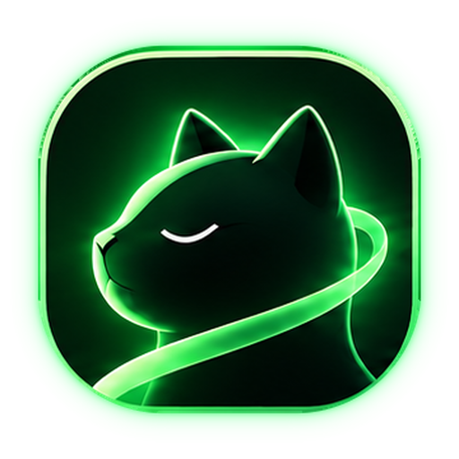

<h1 align="center">
  <br>
  BUIA
</h1>

> **bu·ia** · Italian /ˈbuja/ (*BOO-ya*) · *adjective*, feminine of *buio*
>
> Dark; without light.
>
> **BUIA**: *Bottega Unipersonale d'Intelligenza Artificiale*, a one-person AI workshop.

A local standalone personal assistant: llama.cpp (router mode, CUDA) plus a small FastAPI agent and a web UI.
It generates text, images and videos, reads and writes your notes through file tools, remembers things in `BUIA.md`, streams replies, keeps chat history as JSON files, and can be reached from your phone over Tailscale.

## Requirements

- Windows 11, Docker Desktop (WSL2 backend) with NVIDIA GPU support
- NVIDIA driver recent enough for CUDA 13 (the compose file uses `server-cuda13`, pinned by digest to a known working build; for an older driver change the image to `server-cuda` and drop the digest)
- Git. Tailscale if you want phone access.

## Install

```powershell
mkdir $HOME\buia -Force; cd $HOME\buia
git clone https://github.com/carlocontaldi/buia.git buia-stack
cd buia-stack
.\install.cmd              # add -Tailscale to expose it to your tailnet, -Sd for image/video generation
```

`install.ps1` checks Docker and GPU access, creates `.env` from `.env.example` (with `BUIA_PATH` set to the folder
above the repo), creates `BUIA.md` from `templates/BUIA.md` if it does not exist, builds and starts the stack,
and waits until it answers. It never overwrites an existing `.env` or `BUIA.md`.

Keep the clone directly inside your buia folder (any name): it sits in the folder the agent can read and write, and the agent's
file tools refuse it (they recognise it by `install.ps1` and `docker-compose.yml`) because it holds `.env` and the scripts you run.
They also refuse `.obsidian/` (plugins there are code Obsidian runs), and the `vault/` mount is read-only. The agent's notes live in `memory/`.

Then open http://127.0.0.1:8000 and log in with the password the installer printed (it is saved in `.env` as `BUIA_PASSWORD`; edit it there and run
`docker compose up -d` to change it). Click **Models**, check a Hugging Face repo, download a quant marked `fits`, click **Use**.

## Update

```powershell
cd $HOME\buia\buia-stack
.\update.cmd               # git pull + rebuild + restart
.\update.cmd -Llama        # same, and show the digest of the newest llama.cpp server image (the compose file keeps the pinned one until you change it)
```

The first update that brings the login adds a random `BUIA_PASSWORD` to your `.env` and prints it. If the login page says `BUIA_PASSWORD` is not set,
you updated with an older `update.ps1`: run `.\update.cmd` once more.

## Phone (Tailscale)

`.\install.cmd -Tailscale`, or by hand: `tailscale serve --bg 8000`. Open the `https://...ts.net` address from
`tailscale serve status` on a phone signed in to the same tailnet. Use `serve`, never `funnel`: the agent
is protected by one shared password only, and it can write notes. Everyone on your tailnet can reach the login page, so limit that to your own devices in the Tailscale access rules.

## What lives where

| In the repo | Outside the repo (never committed) |
|---|---|
| `agent/` code and web UI, `docker-compose.yml`, scripts, `templates/BUIA.md` | `.env` (paths, token, password), `BUIA.md`, `chats/`, `generated/`, `.buia-settings.json`, your notes (`memory/`), downloaded chat models (Docker volume `models`), `sdcpp/` and `sdmodels/` |

## Settings

All settings are in `.env` (see `.env.example` for each one). Common ones: `CTX_SIZE`, `KV_CACHE_TYPE`,
`MEMORY_FILES` (which `.md` files are loaded on every request; default `BUIA.md`, `memory/*.md`, `memory/Projects/*.md`), `GPU_VRAM_MB` (only if the Models panel cannot read the GPU),
`ALLOWED_HOSTS` (extra host names for the web UI; see Security), `BUIA_PASSWORD` (the web UI password).

## Troubleshooting

- `docker compose config` prints the resolved configuration and catches path or syntax mistakes.
- `docker compose logs llama --tail 50` and `docker compose logs agent --tail 50` show what each container is doing.
- Models panel says the GPU is not detected: set `GPU_VRAM_MB` in `.env`, then `docker compose up -d`.

## Image and video generation (optional)

`.\install.cmd -Sd` clones stable-diffusion.cpp (pinned release, with submodules) into `sdcpp\`, creates `sdmodels\`,
and builds the `sd` service from `docker-compose.yml`. The first build compiles it for CUDA and takes a while.

1. Open **Models**, scroll to **Image and video models**, click **Download** on a preset (Z-Image Turbo for images, Wan 2.1 T2V 1.3B or Wan 2.2 TI2V 5B for video),
   then **Use**. Downloads come from Hugging Face into `sdmodels\`, resume after a cancel or a dropped connection, and are checked against
   their sha256. **Use** makes the sd server restart with that model a few seconds later (`sd-run.sh` watches `sdmodels\active-image.args`
   and `active-video.args`). There is no fit check for these yet; the Wan 2.1 preset was measured at 512x512 with 33 frames on 8 GB, Wan 2.2 TI2V 5B not yet.
   Only these presets can be downloaded: each model family needs its own set of files and flags.
   (Doing it by hand still works: put the files into `sdmodels\`, set `SD_ARGS` / `SD_VIDEO_ARGS` in `.env` as in `.env.example`, then
   `docker compose --profile sd up -d`. They apply while no model has been chosen with Use.)
2. The sd server runs one model at a time: an image model cannot make videos and the other way round, which is why there are two servers.
3. Ask the assistant for an image or a video. Before each job the chat model is unloaded to free VRAM and loads again on your next message.
   Results are saved in `generated\` inside your workspace folder and shown inline in the chat.

`tools\sd_smoke.py` runs one small video job against the sd server to check it end to end (instructions at the top of the file).
`.\update.cmd` rebuilds the sd service too once `sdcpp\` exists.

A generation keeps running if you close the page, the phone sleeps or you press Stop; the result is added to the chat when it is done
(reopen the chat to see it). The chat accepts the next message after that. Stop does not cancel the job itself.
Every service keeps only its newest 60 MB of Docker logs (3 files of 20 MB). `docker compose logs sd | findstr /c:"compute buffer"` shows the buffer sizes of the last job.

## Security

The web UI is protected by one password (`BUIA_PASSWORD` in `.env`): every API call except the login and the health check needs the session cookie that a login sets (HttpOnly, `SameSite=Strict`,
valid 30 days, signed with a key derived from the password, so changing the password logs everyone out). Five wrong passwords in a row lock the login for a minute.
Without a password nobody can log in. It is meant for `localhost` and your own tailnet, not for the open internet. Notes, search results and web pages can contain text that
tries to give the model orders (prompt injection). The prompt tells the model to treat file text as data, but that is only a request,
so the limits that matter are in the code:

- The web UI answers only to the host names `localhost`, `127.0.0.1` and `*.ts.net` (plus `ALLOWED_HOSTS` in `.env`), so a web page you visit
  cannot reach the agent on your PC through DNS rebinding.
- Names that Windows reads as another file are refused: 8.3 short names (`OBSIDI~1`), a trailing dot or space, `:` (NTFS streams) and device names
  such as `NUL` or `COM1`. Without that, `memory.` or `OBSIDI~1` could get past the checks on `.obsidian` and the memory files, which compare spellings.
- The file tools write `.md` and `.txt` files only: no scripts, no `.json` (chats, settings), no media. `overwrite` must be a real `true`.
- Memory files (`MEMORY_FILES`) are loaded into every later prompt, so whatever lands in them acts like a standing instruction. After the model
  has read any other file in a message, it cannot change them in that message; the user asks again in a new one.
- No new message in a chat while its generation is running. There is no limit on how many images or videos one message can ask for; only `MAX_STEPS` (8 tool rounds per message) stops a runaway loop, and Stop does not cancel a job that already started.

Not covered: if Obsidian has plugins that run code found in notes (Dataview JS, Templater), a note the agent wrote could run when you open it.
Keep those off for the folders the agent writes to.

## Updating dependencies

`agent/requirements.txt` is a lock file: every package is pinned with hashes and installed with `--require-hashes`, so a rebuild installs exactly
those files or fails. `agent/requirements.in` lists the direct dependencies. To upgrade on purpose, regenerate the lock inside the same Python image
the agent runs on (`--upgrade` moves every pin to the newest version; without it pip-compile keeps the existing pins), then rebuild and try the chat, a tool call and an image:

```powershell
docker run --rm -v "${PWD}/agent:/w" -w /w python:3.12-slim sh -c "pip install -q pip-tools && pip-compile -q --upgrade --generate-hashes --strip-extras requirements.in"
docker compose up -d --build agent
```

The base image tag `python:3.12-slim` in `agent/Dockerfile` can still move on a rebuild. To freeze it, run the two commands in the comment at the top of
the Dockerfile and replace the tag with the printed `python@sha256:...` value (the llama image is already pinned that way).
