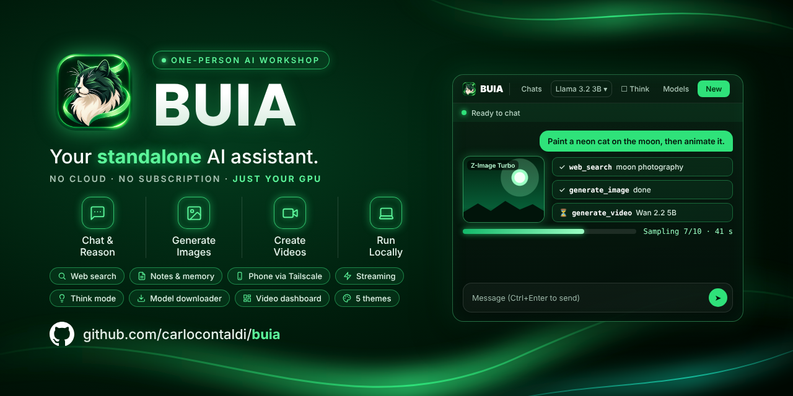

<h1 align="center">
  <br>
  BUIA
</h1>

> **bu·ia** · Italian /ˈbuja/ (*BOO-ya*) · *adjective*, feminine of *buio*
>
> Dark; without light.
>
> **BUIA**: *Bottega Unipersonale d'Intelligenza Artificiale*, a one-person AI workshop.

<br>

A local standalone personal assistant: llama.cpp (router mode, CUDA) plus a small FastAPI agent and a web UI.
It generates text, images and videos, reads and writes your notes through file tools, searches the web and reads pages, remembers things in `BUIA.md`, streams replies, keeps chat history as JSON files, and can be reached from your phone over Tailscale.

<br>

<p1 align="center">
  <br>
</p1>

| Service | Started | What it does |
|---|---|---|
| `llama` | always | llama.cpp server in router mode: the chat models, one in VRAM at a time |
| `agent` | always | the FastAPI agent and the web UI on `127.0.0.1:8000` (the only published port) |
| `searxng` | always | the search engine behind `web_search` (no published port) |
| `sd`, `sd-video` | `-Sd` | stable-diffusion.cpp: image generation and video generation (Wan) |
| `cogvideo` | `-CogVideo` | CogVideoX 2B video generation (Diffusers, PyTorch) |

## Requirements

- Windows 11, Docker Desktop (WSL2 backend) with NVIDIA GPU support
- NVIDIA driver recent enough for CUDA 13 (the compose file uses `server-cuda13`, pinned by digest to a known working build; for an older driver change the image to `server-cuda` and drop the digest)
- Git. Tailscale if you want phone access.
- Developed and measured on one machine: ASUS TUF Gaming A16, RTX 5050 Laptop GPU (8 GB VRAM), 32 GB RAM. The image and video presets assume that size; see the notes in each section.

## Install

```powershell
git clone https://github.com/carlocontaldi/buia.git $HOME\buia
cd $HOME\buia
.\install.cmd              # add -Tailscale to expose it to your tailnet, -Sd for image/video generation, -CogVideo for the CogVideoX video model
```

The buia folder is the repository. `install.cmd` runs `buia-core\install.ps1`, which checks Docker and GPU access, creates `buia-core\.env` from `.env.example`
(with `BUIA_PATH` set to the buia folder, the one above `buia-core`), creates `BUIA.md` from `templates/BUIA.md` if it does not exist,
builds and starts the core, and waits until it answers. It never overwrites an existing `.env` or `BUIA.md`.

The buia folder is also the folder the agent can read and write (`BUIA_PATH`). `buia-core\` holds `.env` and the scripts you run, so the agent's
file tools refuse it (they recognise it by `install.ps1` and `docker-compose.yml`): keep `.env` there, not next to `BUIA.md`.
They also refuse `.git`, `templates/` and `README.md` at the top of the buia folder (they belong to the repo) and `.obsidian/` (plugins there are code Obsidian runs), and the `vault/` mount is read-only. The agent's notes live in `memory/`.

Run the `docker compose` commands in this README, and the test and lock-file commands at the end, in `buia-core\`: that is where `docker-compose.yml` and `.env` are.

Then open http://127.0.0.1:8000 and log in with the password the installer printed (it is saved in `.env` as `BUIA_PASSWORD`; edit it there and run
`docker compose up -d` to change it). Click **Models**, check a Hugging Face repo, download a quant marked `fits`, click **Use**.

## Web UI

- **Models** downloads and selects chat models (Hugging Face repo, quant marked `fits` or not) and, below that, the image and video presets.
- **Video dashboard** (button in Models, under the image and video presets) makes videos from a form with a progress bar, see [Video dashboard](#video-dashboard).
- **Think** lets the model reason before it answers (slower, uses more context). Off by default; the choice is kept per browser.
- **Theme** (the selector in the header): Plain, Light, Dark, Sepia, BUIA. Plain is the default and follows your operating system's light or dark setting; the choice is kept per browser.
- **Chats** lists the chats saved as JSON files in `chats\` inside your buia folder. The list is paged; an unreadable chat can be downloaded for recovery. **Generated media** opens the saved image/video gallery. Files referenced by chats cannot be deleted until those chats are removed.

## Update

```powershell
cd $HOME\buia
.\update.cmd               # git pull + rebuild + restart
.\update.cmd -Llama        # same, and show the digest of the newest llama.cpp server image (the compose file keeps the pinned one until you change it)
```

The first update that brings the login adds a random `BUIA_PASSWORD` to your `.env` and prints it. If the login page says `BUIA_PASSWORD` is not set,
you updated with an older `update.ps1`: run `.\update.cmd` once more.

## Phone (Tailscale)

`.\install.cmd -Tailscale`, or by hand: `tailscale serve --bg 8000`. Open the `https://...ts.net` address from
`tailscale serve status` on a phone signed in to the same tailnet. Use `serve`, never `funnel`: the agent
is protected by one shared password only, and it can write notes. Everyone on your tailnet can reach the login page, so limit that to your own devices in the Tailscale access rules.

## What lives where

| In git | Not in git (git-ignored or kept elsewhere, never committed) |
|---|---|
| `buia-core/` (`agent/` code and web UI, `docker-compose.yml`, scripts), `templates/`, `tools/`, `assets/`, `install.cmd`, `update.cmd` | `buia-core/.env` (paths, token, password), `BUIA.md`, `chats/`, `generated/`, `.buia-settings.json`, your notes (`memory/`), downloaded chat models (Docker volume `models`), `sdcpp/` and `sdmodels/` |

## Settings

All settings are in `.env` (see `.env.example` for each one). Common ones: `CTX_SIZE`, `KV_CACHE_TYPE`,
`MEMORY_FILES` (which `.md` files are loaded on every request; default `BUIA.md`, `memory/*.md`, `memory/Projects/*.md`), `GPU_VRAM_MB` (only if the Models panel cannot read the GPU),
`ALLOWED_HOSTS` (extra host names for the web UI; see Security), `BUIA_PASSWORD` (the web UI password), `WEB_ACCESS` (`on` by default; see Web access).

## Troubleshooting

- `docker compose config` prints the resolved configuration and catches path or syntax mistakes.
- `docker compose logs llama --tail 50` and `docker compose logs agent --tail 50` show what each container is doing.
- Models panel says the GPU is not detected: set `GPU_VRAM_MB` in `.env`, then `docker compose up -d`.

## Web access

The assistant can search the web and read pages, and it can do so from the first start: `web_search` asks a bundled [SearXNG](https://docs.searxng.org/)
(compose service `searxng`, no account or API key, no published port) and `web_fetch` reads one page as plain text with its links.
The first start downloads the SearXNG image. To turn the tools off, set `WEB_ACCESS=off` in `.env` and run `docker compose up -d`; the `searxng`
container then idles unless you also run `docker compose stop searxng`. If a search says it is not available, `docker compose logs searxng --tail 50` shows why.
Searches go out from your PC through SearXNG to Brave, DuckDuckGo, Google and other engines, so they are as visible to those as any search you type yourself.

The `searxng` image is the moving `latest` tag, unlike the llama image. To freeze it, follow the comment above the service in `docker-compose.yml`.

## Image and video generation (optional)

`.\install.cmd -Sd` clones stable-diffusion.cpp (pinned release, with submodules) into `sdcpp\`, creates `sdmodels\` (both in `buia-core\`),
and builds the `sd` service from `docker-compose.yml`. The first build compiles it for CUDA and takes a while.

1. Open **Models**, scroll to **Image and video models**, click **Download** on a preset (Z-Image Turbo for images, Wan 2.1 T2V 1.3B or Wan 2.2 TI2V 5B for video),
   then **Use**. Downloads come from Hugging Face into `sdmodels\`, resume after a cancel or a dropped connection, and are checked against
   their sha256. **Use** makes the sd server restart with that model a few seconds later (`sd-run.sh` watches `sdmodels\active-image.args`
   and `active-video.args`). Each model shows a verdict like the chat models do (fits, tight, needs RAM offload, may not fit) with the reason
   as a tooltip in the check box: streamed sd presets use the resident compute-buffer estimate (or `--max-vram` when set), not the file size;
   CogVideoX uses the transformer + VAE size; a single-file checkpoint adds its exact weights, counted from the safetensors header. The
   compute-buffer part is an estimate per family and is not derived from the header. Unknown sizes show no badge. Wan 2.1 was measured
   at 512x512 with 33 frames on 8 GB; Wan 2.2 TI2V 5B, FLUX.1 schnell, SDXL and SD 1.x not yet. You can also check any Hugging Face repo
   of a supported family and add a file as a custom model: Z-Image Turbo, Wan 2.1 T2V 1.3B, Wan 2.2 TI2V 5B and FLUX.1 schnell (GGUF, found by
   file name; they reuse the preset's companion files and flags), and single-file SD 1.x or SDXL checkpoints (`.safetensors`, found by their
   tensor names, whatever the file is called; distilled ones such as Turbo or Lightning get a warning because the flags are for standard models).
   CogVideoX has no customs: its service reads one fixed folder. Customs are saved in `sdmodels\custom.json` and use the same Download / Use / Delete buttons.
	   CogVideoX has no customs: its service reads one fixed folder. Custom model paths containing whitespace or shell wildcards (`*?[]`) are refused
	because the sd runner passes model flags as shell words. Customs are saved in `sdmodels\custom.json` and use the same Download / Use / Delete buttons.
   (Doing it by hand still works: put the files into `sdmodels\`, set `SD_ARGS` / `SD_VIDEO_ARGS` in `.env` as in `.env.example`, then
   `docker compose --profile sd up -d`. They apply while no model has been chosen with Use.)
2. The sd server runs one model at a time: an image model cannot make videos and the other way round, which is why there are two servers.
3. Ask the assistant for an image or a video. Before each job the chat model is unloaded to free VRAM and loads again on your next message.
   Results are saved in `generated\` inside your workspace folder and shown inline in the chat.

`tools\sd_smoke.py` runs one small video job against the sd server to check it end to end and saves it in `generated\` (instructions at the top of the file).
`.\update.cmd` rebuilds the sd service too once `sdcpp\` exists.

A generation keeps running if you close the page, the phone sleeps or you press Stop; the result is added to the chat when it is done
(reopen the chat to see it). The chat accepts the next message after that. Stop does not cancel the job itself.
Every service keeps only its newest 60 MB of Docker logs (3 files of 20 MB). `docker compose logs sd | findstr /c:"compute buffer"` shows the buffer sizes of the last job.

### Video dashboard

**Models > Video dashboard** makes a video without going through the chat. Pick a downloaded video model (one that is not in use shows a **Use**
button; the video server restarts and the form waits for it), write the prompt and press **Generate**.

- The form is made from the parameters of the model you picked. **Wan 2.1 / 2.2** (and any model `sd-video` runs): negative prompt, width, height, frames, frames per
  second, steps, cfg scale, sampler, flow shift, seed. Three of them are optional (cfg scale, sampler, flow shift): left empty they keep the flags the model was
  started with, which show as the grey hint. **CogVideoX**: negative prompt, steps (10-50), guidance scale (1-20, default 6) and seed; its 720x480x49 format is fixed.
  Size, frames and steps stop at the limits `generate_video` uses (`VIDEO_MAX_*` in `buia-core/agent/agent.py`). Seed -1 picks a random one; the one used is shown next to the video.
  The values are remembered per model in your browser; **Reset parameters** puts the defaults back.
- The progress bar goes through the phases (waiting, loading, sampling, decoding) and the text beside it gives the exact step: `Sampling 7/10 · 41 s`. The bar is one scale for
  all phases, so its sections are a layout, not shares of the time. CogVideoX reports its steps in the job; stable-diffusion.cpp's job answer has no progress, only its
  output has, so `sd-run.sh` also copies that to the `sdlogs` volume (`active-video.log`, emptied at every server start and when it passes 10 MB) and the agent reads it from there
  (read-only). After an update, `.\update.cmd` recreates the services with it. Without the volume the bar is not filled and shows what is happening and the elapsed time.
- One video at a time: the chat refuses new messages while it runs, because its model would load next to the video model, and the chat model is unloaded before the job like it is for
  `generate_video`. Reloading the page shows the running job again. The video is saved in `generated\` inside your workspace folder (it is not added to a chat).
- **Cancel** under the bar ends the job (and frees the chat again). CogVideoX is stopped at once. stable-diffusion.cpp's server cannot interrupt a job that is
  generating, so the video server is restarted instead (`sd-run.sh` does it, a few seconds; the model loads again on the next job). A video that finishes at the same moment is kept.

### CogVideoX 2B (optional second video engine)

stable-diffusion.cpp cannot run CogVideoX, so `.\install.cmd -CogVideo` builds a separate `cogvideo` service (`buia-core/cogvideo/`: Hugging Face Diffusers on
PyTorch with CUDA; the image is several GB and the first build takes a while). It sets `COGVIDEO=on` in `.env`, which makes `update.cmd` rebuild it too.
It does not need `-Sd`. Then, in **Models**:

1. **Download** *CogVideoX 2B* (about 13.8 GB from `zai-org/CogVideoX-2b` into `sdmodels\CogVideoX-2b\`, checked against sha256 like the other presets), then **Use**.
   From then on `generate_video` sends its jobs to the cogvideo service. **Use** on a Wan preset (or deleting CogVideoX) sends them back to `sd-video`, which is left alone
   in between. Only one video model is in use at a time; image generation is not affected.
2. The model has one format: **720x480, 49 frames at 8 fps (6 s)**, English prompts of at most 226 tokens. The assistant's `width`, `height` and `frames` arguments
   are ignored for it; `steps` go from 10 to 50 (default 50, the model card's value).
3. Each video runs in a fresh process, so the service holds no VRAM or RAM while idle. The 9.5 GB T5 text encoder runs on the CPU first and is freed, then the
   3.4 GB transformer and the VAE take turns on the GPU. It therefore needs about 12 GB of free RAM inside Docker Desktop's WSL2 VM, which by default gets half of your RAM
   (and the other containers share it). If a job ends with "killed: probably out of memory", raise `memory=` in `%UserProfile%\.wslconfig` (`[wsl2]` section) and run `wsl --shutdown`.
4. **Measured on the 8 GB laptop:** about 200-250 s per video at 10 steps (720x480, 49 frames); peak VRAM and RAM not yet recorded (the timeout is 1 hour). Check it once with
   `docker compose cp ..\tools\sd_smoke.py agent:/tmp/sd_smoke.py` and
   `docker compose exec -T -e SD_URL=http://cogvideo:1234 agent python /tmp/sd_smoke.py 720 480 49 10`, while
   `docker compose logs -f cogvideo` shows `step i/N`. If it is too slow, give the assistant fewer steps or lower the default (`COG_DEFAULT_STEPS` in `buia-core/agent/agent.py`).

## Security

The web UI is protected by one password (`BUIA_PASSWORD` in `.env`): every API call except the login and the health check needs the session cookie that a login sets (HttpOnly, `SameSite=Strict`,
valid 30 days, signed with a key derived from the password, so changing the password logs everyone out). Five wrong passwords in a row lock the login for a minute.
Without a password nobody can log in. It is meant for `localhost` and your own tailnet, not for the open internet. Notes, search results and web pages can contain text that
tries to give the model orders (prompt injection). The prompt tells the model to treat file text as data, but that is only a request,
so the limits that matter are in the code:

- The web UI answers only to the host names `localhost`, `127.0.0.1` and `*.ts.net` (plus `ALLOWED_HOSTS` in `.env`), so a web page you visit
  cannot reach the agent on your PC through DNS rebinding.
- Names that Windows reads as another file are refused: 8.3 short names (`OBSIDI~1`), a trailing dot or space, `:` (NTFS streams) and device names
  such as `NUL` or `COM1`. Without that, `memory.` or `OBSIDI~1` could get past the checks on `.obsidian` and the memory files, which compare spellings.
- The file tools write `.md` and `.txt` files only: no scripts, no `.json` (chats, settings), no media. `overwrite` must be a real `true`.
- Memory files (`MEMORY_FILES`) are loaded into every later prompt, so whatever lands in them acts like a standing instruction. After the model
  has read any other file in a message, it cannot change them in that message; the user asks again in a new one.
- Web pages and search results are unvetted text like notes are: after the model has used a web tool in a message, it cannot change the memory files in that message either.
- `web_fetch` opens only an address you wrote in the chat or one that a search or a page listed in that same reply. A page cannot make the model open an address it built
  (for example one with your notes in the query), because such an address was never listed.
- `web_fetch` opens public internet addresses only: `localhost`, your home network, the other containers (the model server, the search server), cloud metadata addresses and
  your tailnet are refused. This is checked again at every redirect, and the connection goes to the address that was checked, so a second DNS answer cannot redirect it.
  It reads at most 1.5 MB of HTML, text, JSON or XML per page, and 8000 characters per tool call.
- No new message in a chat while its generation is running. There is no limit on how many images or videos one message can ask for; only `MAX_STEPS` (8 tool rounds per message) stops a runaway loop, and Stop does not cancel a job that already started.

Not covered: the words of a search are chosen by the model, so a page that tells it to search for something from your notes sends those words to the search engines
(the page's author does not see them). Turn `WEB_ACCESS` off if that matters to you.

Not covered: if Obsidian has plugins that run code found in notes (Dataview JS, Templater), a note the agent wrote could run when you open it.
Keep those off for the folders the agent writes to.

## Running tests

Use Python 3.12, install the same hash-pinned dependencies as the agent, and run the suite from `buia-core\`:

```powershell
python -m pip install --require-hashes -r agent/requirements.txt
python -m unittest discover -s tests -v
```

The API tests require FastAPI and HTTPX; install the locked agent requirements before running discovery so dependency-based skips do not hide
missing coverage. GitHub Actions runs the suite on Linux and Windows; `test_sd_run.py` exercises the Linux container supervisor and is skipped
on Windows. Compose reports agent readiness through `/api/health`, which returns HTTP 503 until llama-server is ready. Installer and updater
wait up to two minutes and fail with recent service logs if readiness is not reached. In the agent container, only `test_sd_job.py` can be
run from a copied `tests` directory because other tests locate source files relative to the repository layout.

## Updating dependencies

`agent/requirements.txt` is a lock file: every package is pinned with hashes and installed with `--require-hashes`, so a rebuild installs exactly
those files or fails. `agent/requirements.in` lists the direct dependencies. To upgrade on purpose, regenerate the lock inside the same Python image
the agent runs on (`--upgrade` moves every pin to the newest version; without it pip-compile keeps the existing pins), then rebuild and try the chat, a tool call and an image:

```powershell
docker run --rm -v "${PWD}/agent:/w" -w /w python:3.12-slim sh -c "pip install -q pip-tools && pip-compile -q --upgrade --generate-hashes --strip-extras requirements.in"
docker compose up -d --build agent
```

`cogvideo/requirements.txt` is a lock file of the same kind (PyTorch with its CUDA libraries, Diffusers, Transformers; Linux, Python 3.12). Regenerating it with pip-compile downloads
every wheel, several GB, so give Docker room:

```powershell
docker run --rm -v "${PWD}/cogvideo:/w" -w /w python:3.12-slim sh -c "pip install -q pip-tools && pip-compile -q --upgrade --generate-hashes --strip-extras --allow-unsafe requirements.in"
docker compose up -d --build cogvideo
```

(`--allow-unsafe` keeps `setuptools` in the file: torch needs it and `python:3.12-slim` does not ship it.) The file in the repo was generated from pip's resolution plus PyPI's hashes instead.
It has been built and run on the 8 GB laptop; a first run failed in the denoising loop because the prompt embeddings were still on the CPU, and `cogvideo/generate.py`
now moves them to the GPU. That fix has not been confirmed by a finished video yet.

The base image tag `python:3.12-slim` in `agent/Dockerfile` can still move on a rebuild. To freeze it, run the two commands in the comment at the top of
the Dockerfile and replace the tag with the printed `python@sha256:...` value (the llama image is already pinned that way).
